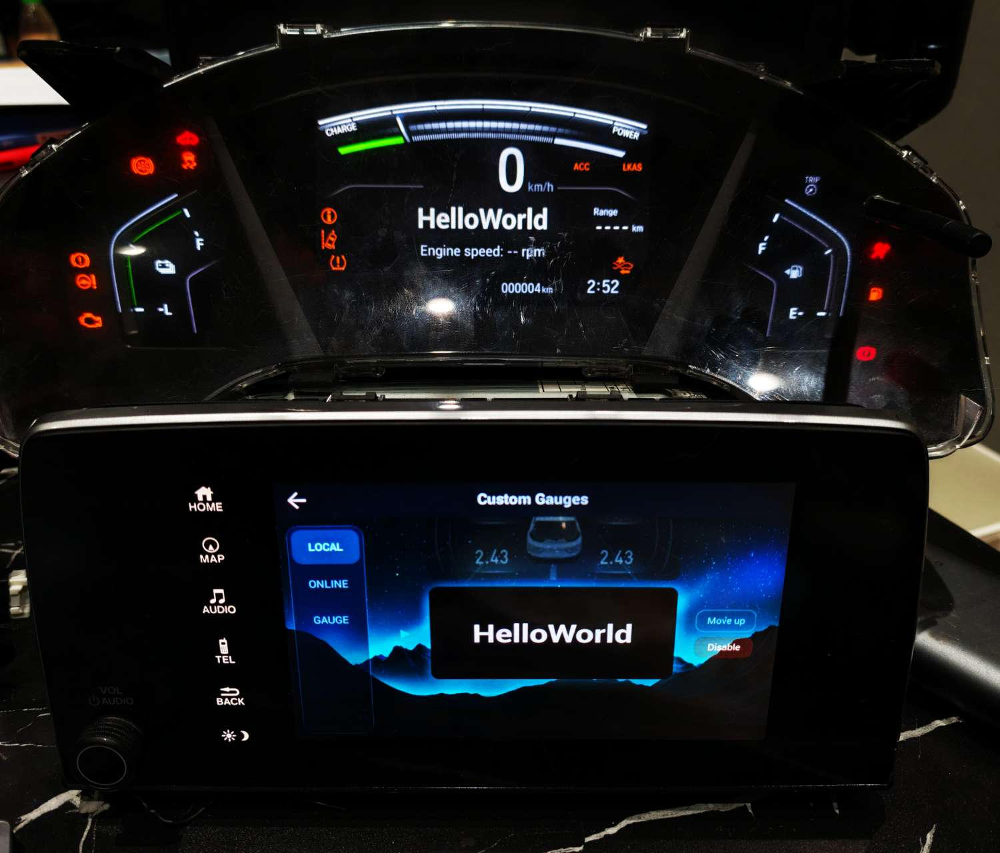

# open_manager

[简体中文](README.md) | English

## Prerequisites

- **Environment**: Android 4.2.2 (API 17) head units only.
- **Supported vehicles**: Honda 10th-gen Civic, Avancier, UR-V, CR-V, Breeze, and Acura CDX.
- **Host dependency**: the head unit must have the `com.automanager` app installed. It provides vehicle data acquisition and the ability to render custom Views on the factory instrument cluster; without it, neither the libraries nor the demo in this repository can run.
- **How to use**:
    1. On the head unit browser, open https://7654321.org and install the "Manager" app.
    2. Build the APK in `demos/dashboard_demo1` (or just run `sh_build.sh`) and install it on the head unit. Open the "Manager" app, tap "Custom Dashboards"; the local dashboards page will automatically discover the newly implemented dashboard service.
    3. 

## Overview

Open-source modules for car head-unit dashboards (instrument clusters) and vehicle data SDKs.
Targets Android 4.2.2 (API 17) head units and is consumed as Gradle source projects by apps
in the com.automanager ecosystem.

The repository contains two library modules and one runnable dashboard demo:

```
open_manager/
├── Lib_common/            # Shared base library: vehicle model constants, vehicle data snapshot & consumer SDK, log/view utilities
├── Lib_dashboard/         # Dashboard SDK: dashboard service base class, AIDL contract, cluster window utilities
└── demos/
    └── dashboard_demo1/   # HelloWorld dashboard demo app (standalone Gradle project)
```

## Modules

### Lib_common

| Type | Description |
| --- | --- |
| `com.automanager.Const` | Vehicle model code constants (`TBAA` (Civic) / `TEAA` (Civic) / `TLAA` (Breeze) / `TRTA` (CR-V) / `TRVA` (CR-V) / `TRWA` (CR-V) / `THAA` (Avancier / UR-V) / `TRNA` (Acura CDX)) used for cluster bounds and layout adaptation |
| `com.automanager.vehicle.VehicleData` | Full vehicle data snapshot (`Parcelable`, passed over AIDL). `validMask` marks valid fields, `changedMask` marks fields changed in the current broadcast; check `hasField(int)` before reading a field. New fields are appended at the Parcel tail with a version number, keeping older consumers compatible |
| `com.automanager.vehicle.VehicleDataManager` | Consumer-side singleton: binds to the host data service, registers listeners, dispatches on the main thread, and reconnects with exponential backoff (1s → 30s) |
| `IVehicleDataService` / `IVehicleDataListener` (AIDL) | Consumer contract: fetch snapshots, register/unregister listeners, read/write custom config, and a debug-only mock data session |
| `VehicleDataServiceUnavailableException` | Checked exception thrown when a remote API is used while the service is not connected |
| `VehicleCustomConfig` | Host config injection bridge: the host `Application` registers its read/write implementation via `setImplementation` |
| `com.manager.utils.CLog` | Lightweight log wrapper; `isDebug` is enabled by the host. `dfile` is a no-op by default and can be routed by the host via `DLogHandler` |
| `com.automanager.view.NoPaddingTextView` | TextView without extra top/bottom padding, making icon and number alignment easier |

### Lib_dashboard

| Type | Description |
| --- | --- |
| `BaseDashboardService` | Abstract base class for dashboard services. It creates the cluster `WindowManager`, maintains the pure-black background overlay, and dispatches AIDL callbacks on the main thread; subclasses implement only 4 hooks |
| `IDashboardService` (AIDL) | `dbShow(vehicleModel)` / `dbHide()` / `dbOpenConfig()` / `dbInfo()`, invoked cross-process by the host dashboard manager |
| `DashboardInfo` | Dashboard metadata: `title`, `thumb` (preview image bytes), `withCustomConfig` (whether a config page exists), `rank` (default sort weight, larger comes first) |
| `utils.Util` | `ACTION_DASHBOARD_SERVICE` discovery action, `EXTRA_VEHICLE_MODEL` extra, vehicle bounds (`getLayoutBound` / `getContentBound` / `getScale`), `getRootViewLayoutParam`, `createWindowManager` (uses the second display), `readThumbBytes` (thumbnails), and black background helpers `showBlackBackground` / `hideBlackBackground` |

## Requirements

- JDK 17 (required by AGP 7.4.2)
- Android SDK Platform 33, Build-Tools 33.x
- Gradle 7.5 (the demo ships its own wrapper)
- `compileSdk 33`, `minSdk 17` / `targetSdk 17`, runs on Android 4.2.2 head units
- Support-library stack only; the host project must keep `android.useAndroidX=false` and `android.enableJetifier=false`
- The cluster window requires a dual-display environment: `Util.createWindowManager` takes the last Display and throws on single-display devices (the base class catches and logs it)

Before running the demo, write your local SDK path into `demos/dashboard_demo1/local.properties`
(this file is not committed):

```properties
sdk.dir=/path/to/Android/sdk
```

## Build the Demo

```sh
cd demos/dashboard_demo1
./gradlew :app:assembleDebug
```

Output: `app/build/outputs/apk/debug/app-debug.apk`.

The demo package is `com.automanager.demo.dashboard`; the core implementation is in
`app/src/main/java/com/automanager/demo/dashboard/DashboardDemoService.java`.
Once installed, the host (the Assistant local-dashboard page) discovers it by scanning for
`ACTION_DASHBOARD_SERVICE`; selecting it renders HelloWorld on the cluster and, below it, the live
engine speed obtained by subscribing to `VehicleData` (`FIELD_ENGINE_RPM`) through
`VehicleDataManager`; the preview card is titled "HelloWorld Demo".

## Integrate into Your App

Reuse the code as Gradle source projects; no Maven artifacts are published. `settings.gradle`:

```groovy
include ':app', ':Lib_common', ':Lib_dashboard'
project(':Lib_common').projectDir = new File('../open_manager/Lib_common')
project(':Lib_dashboard').projectDir = new File('../open_manager/Lib_dashboard')
```

Module `build.gradle`:

```groovy
dependencies {
    implementation project(':Lib_common')
    implementation project(':Lib_dashboard')
}
```

> `Lib_common` has no host binary AAR dependency. `CLog.dfile` is a no-op by default; the host can
> inject `CLog.dlogHandler` to route those logs to its own channel.

## Build a Custom Dashboard

1. Extend `BaseDashboardService` and implement the 4 hooks (all called on the main thread);
2. Export the Service in the manifest and declare the discovery action;
3. Declare the cluster overlay permissions.

```java
public class MyDashboardService extends BaseDashboardService {
    private View rootView;

    @Override
    protected void onDashboardShow() {
        // Remove the old view first so repeated dbShow for the same model stays idempotent
        removeRootView();
        rootView = new TextView(this);
        ((TextView) rootView).setText("My Dashboard");
        WindowManager.LayoutParams lp =
                Util.getRootViewLayoutParam(vehicleModel, mockWindowManager());
        try {
            getWindowManager().addView(rootView, lp);
        } catch (Throwable e) {
            // Reset on addView failure; otherwise the stale state blocks later dbShow calls
            rootView = null;
        }
    }

    @Override
    protected void onDashboardHide() {
        removeRootView();
    }

    private void removeRootView() {
        if (rootView == null) return;
        try {
            getWindowManager().removeView(rootView);
        } catch (Exception ignored) {
        }
        rootView = null;
    }

    @Override
    protected void onDashboardOpenConfig() {
        // Nothing to do when DashboardInfo.withCustomConfig = false
    }

    @Override
    protected DashboardInfo onDashboardInfo() {
        DashboardInfo info = new DashboardInfo();
        info.title = "My Dashboard";
        info.thumb = Util.readThumbBytes(getResources(), R.drawable.my_preview);
        info.withCustomConfig = false;
        info.rank = 1900; // Built-in dashboards use 2000+; larger values sort first
        return info;
    }
}
```

Manifest:

```xml
<uses-permission android:name="android.permission.INTERNAL_SYSTEM_WINDOW" />
<uses-permission android:name="android.permission.SYSTEM_ALERT_WINDOW" />
<uses-permission android:name="android.permission.SYSTEM_OVERLAY_WINDOW" />

<service
    android:name=".MyDashboardService"
    android:exported="true">
    <intent-filter>
        <action android:name="com.automanager.dashboard.action.DASHBOARD_SERVICE" />
    </intent-filter>
</service>
```

Key points:

- `BaseDashboardService` owns window creation, the black background, and main-thread dispatch; do not manage `WindowManager` add order yourself;
- `vehicleModel` is passed by the host via the bind intent (`Util.EXTRA_VEHICLE_MODEL`); the base class hides the old view first when the model changes;
- `getWindowManager()` is available only after `dbShow`; `mockWindowManager()` returning `true` uses the primary display (debug only).

## Subscribe to Vehicle Data

```java
VehicleDataManager mgr = VehicleDataManager.getInstance();
mgr.connect(context);                       // Implicit bind to the host service
// For cross-app consumption, specify the host package explicitly:
// mgr.connect(context, "com.automanager", null);

mgr.addListener(new VehicleDataManager.OnVehicleDataListener() {
    @Override
    public void onVehicleDataChanged(VehicleData data) {
        if (data.hasField(VehicleData.FIELD_VEHICLE_SPEED)) {
            float speed = data.vehicleSpeed; // km/h
        }
    }
});

// When no longer needed (Application/page destroyed):
mgr.removeListener(listener);
mgr.disconnect();
```

- Right after registration the server pushes one full snapshot, then broadcasts on field changes;
- Callbacks are delivered on the main thread; the SDK reconnects and re-registers listeners after the service process restarts;
- This SDK is a read-only consumer channel and contains no vehicle data acquisition/reporting APIs;
- Remote calls such as `getVehicleData()` / `putCustomConfig()` throw
  `VehicleDataServiceUnavailableException` while disconnected. For debugging, use
  `beginMock()` / `reportMockData()` / `endMock()` to inject mock snapshots.

## Tests

```sh
python3 Lib_dashboard/tests/test_lifecycle.py
```

The test compiles and runs the real `BaseDashboardService` with `javac` plus host window/queue
fixtures, verifying the `dbShow` / `dbHide` lifecycle, the main-thread queue, and black-background
view ordering — no Android device required.
